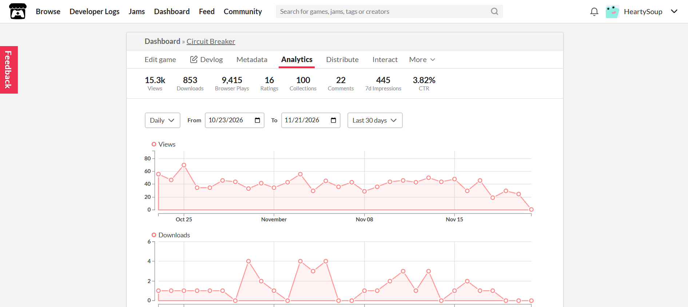

# Circuit Breaker
**GMTK Game Jam 2026 — Mark Brown's Top 20 Favourites (out of 10,500+ entries)**

Built in Unity in 96 hours by a team of two. Theme: "Count Down".

▶ **Play it:** https://sp1cyham.itch.io/circuit-breaker

🎥 **Featured in the Top 20 video:** https://www.youtube.com/watch?v=awegilW3DTc&t=288s

## My role — Lucas Ma, Lead Developer
- Came up with the core concept and built the gameplay from the ground up: game mechanics, all 25 levels, and player controls
- Kept the project scoped to what two people could polish in 96 hours, putting fun ahead of feature count
- Worked alongside SpicyHam, who created the art, audio, music and visual effects

## Reach
10,000+ plays and downloads since release (itch.io analytics):

## About the game
- A challenging puzzle game where you set your own countdown
- Lay down wire across the level, then traverse it to complete tasks while the wire burns down as your timer
- 25 handcrafted levels
